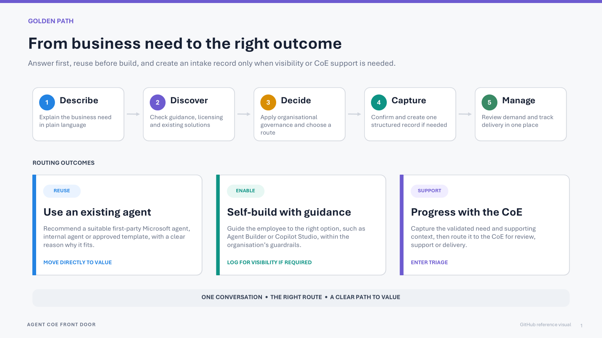

# Agent CoE Front Door

A reusable Copilot Studio and Power Platform reference solution for agent discovery, guidance, confirmed intake, and CoE triage.

**A complete starter template, not a production-ready product.** It sets up quickly with three personas: an **Admin** who sets it up, **CoE Reviewers** who triage requests in a model-driven app, and **Employees** who chat with the agent. The package contains the actual Agent CoE Front Door agent, not a test agent. Optional instruction discovery is off by default; employees only ever see a short AI summary of what an agent does, never its instructions.

**Release:** `v1.0.0`, unmanaged solution version `1.0.0.0`. Offline package checks do not prove live operation; install and test in your own non-production environment before any production use.

## What it does

The front door follows **answer first, intake second**. Employees can describe a business need, find approved guidance and reusable catalogue entries, choose an approved self-build or CoE-supported route, and review a summary before any intake record is written. Pure informational questions and reuse without a new build do not create records. An agreed concrete self-build is logged for visibility only after confirmation. The agent describes other agents only by what they do, and never reveals instructions or other people's requests.

For richer discovery, an optional add-on lets the existing inventory flow cache native instruction-bearing authoring definitions from explicitly approved Dataverse environments. The flow adds a short AI summary of what each agent does, which the advisor searches and shares; raw definitions stay in secured columns for CoE reviewers. JSON and OBI/YAML remain labelled native definitions; no parser plugin, Custom API, external parsing service, or additional flow is required.

CoE reviewers manage requests in a model-driven triage app. A configurable agent flow emails the requester when the CoE changes a request to **Approved** or **Rejected**. It records the send outcome, suppresses repeated notifications for the same decision, and sends again when the notified decision changes between approval and rejection.

These are intended capabilities of the reference pattern, not measured business savings or a production-readiness guarantee.



## Included

- Copilot Studio agent, advisor and intake skills, and Dataverse MCP tool.
- Agent Catalogue, Agent Intake Request, and Tenant Agent Inventory Dataverse tables.
- Model-driven triage app, generative dashboard, and an **Agent CoE Reviewer** security role (no delete rights) mapped to the app.
- Disabled daily Power Platform Inventory API refresh and its custom connector.
- Restricted native instruction-definition enrichment in that same flow and table, with a separate inventory Dataverse reference and approved-source settings.
- Disabled approval/rejection requester email flow, separate Dataverse and Outlook connection references, and customizable notification settings.
- Three organization-neutral knowledge templates in `knowledge/`, supplied separately from the ZIP.
- Exploded solution source, reproducible packaging, offline regression checks, and deployment documentation.

The **Agent Catalogue** is the source of truth for what the CoE has reviewed and approved. **Tenant Agent Inventory** is the optional daily source of truth for which agents exist in the tenant. The agent can tell employees about a relevant published agent (name, status and a short description, labelled as not reviewed by the CoE), but never its instructions, owners or identifiers. Its API source covers Copilot Studio / Microsoft 365 Copilot Agent Builder resources returned by Power Platform, not all pro-code/custom-engine agents or all tenant resources.

## Package and versioning

The solution package is `release/AgentCoEFrontDoor_1_0_0_0.zip`. Its SHA-256 is recorded in [SHA256SUMS](release/SHA256SUMS) and [the release manifest](release/manifest.json).

The release tag uses `vMAJOR.MINOR.PATCH`; the Power Platform solution requires four numeric components and uses `MAJOR.MINOR.PATCH.REVISION`. Publish changes as a new version; do not overwrite an already released tag or its ZIP.

Version 1.0.0.0 is intended for **fresh installation** in an empty environment. Never import an older-numbered package over an existing higher version.

## Deployment and acceptance

Start with an empty non-production Dataverse environment. Both flows ship **Off**, target connections are unbound, organization knowledge is not attached, and notification/source settings contain no target values.

Both flows are Copilot Studio agent flows. Turn them on from the solution and don't save or publish them in a flow designer, which removes their built-in protections; see [about the two flows](docs/INSTALLATION.md#about-the-two-flows).

Only connector definitions and unbound connection references are distributed, not live connections or credentials. You sign in through Microsoft's own prompts in your environment; see [no credentials in this package](docs/INSTALLATION.md#no-credentials-in-this-package). This repository is not a secret store.

1. Follow the one-page [setup guide](docs/INSTALLATION.md): import, check connections, add knowledge, turn on the decision email, share the agent, and assign reviewers.
2. Run the [end-to-end check](docs/INSTALLATION.md#end-to-end-check) with one Admin, one Reviewer, and one Employee account.
3. Add [optional add-ons](docs/INSTALLATION.md#optional-add-ons) only if needed: [Power Platform inventory](docs/POWER-PLATFORM-INVENTORY.md) and [restricted instruction discovery](docs/INSTRUCTION-DISCOVERY.md).
4. Before real use, work through [before production](docs/INSTALLATION.md#before-production) and the [test prompts](docs/TEST-PROMPTS.md), including non-admin and unauthorized-user checks.

Known portability gates must be checked rather than assumed away: imported parent instructions can require restoration in the Studio designer; MCP can need a target-native connection; knowledge must retrieve independently, not merely show Ready; dashboard support and agent/model availability depend on the target tenant.

Keep test identities, environment URLs, mail, screenshots, transcripts, customer content, and detailed run evidence outside the repository. Do not describe any unexecuted or blocked acceptance gate as passed.

## Offline checks

With Python 3.10 or later, run from the repository root:

```powershell
python scripts\release.py verify
python -m unittest discover -s tests -v
```

To rebuild the package after an intentional source change:

```powershell
python scripts\release.py build
```

The verifier checks source/ZIP byte parity, deterministic packaging, manifest/checksum consistency, structured-file parsing, disabled flows, and selected portability constraints. Regression tests also check notification wiring, duplicate guards, receipt ordering, and failure paths. These checks do **not** execute Power Automate, send mail, prove employee isolation, or replace a clean import and live acceptance.

See [Solution overview](docs/SOLUTION-OVERVIEW.md) and [User stories](docs/USER-STORIES.md) for scope and expected outcomes.

## Important disclaimer

This repository is a reusable reference template provided **as is**. It is not an official Microsoft product, endorsed reference architecture, certification, or support commitment.

Non-production validation is not a guarantee that the solution is secure, compliant, licensed, suitable, or operationally ready for another organization. Adopters are responsible for their own review, configuration, testing, licensing, capacity, security, privacy, DLP, accessibility, support, and change management.

Do not use example placeholders as approved policy. Do not add credentials, tokens, customer data, internal documents, private links, or production records to this repository.

See [NOTICE.md](NOTICE.md) for the full disclaimer and [LICENSE](LICENSE) for licensing terms.

## Compatibility identifiers

The solution retains the existing `cat_` Dataverse schema prefix and related internal component identifiers. They are technical identifiers, not adopting-organization branding. Keep them unchanged so future versions update the same components.
