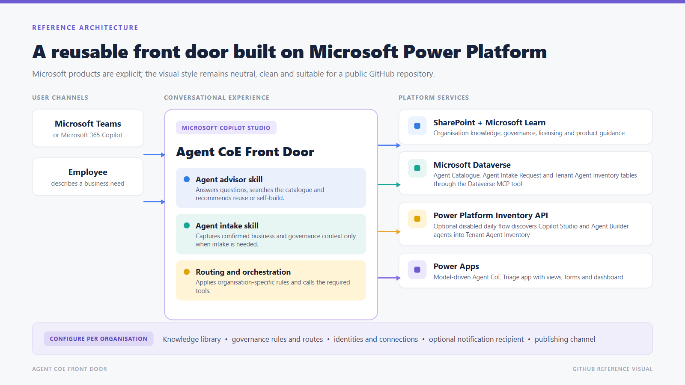

# Solution overview

Agent CoE Front Door is a reusable intake and triage pattern for organizations that want a governed entry point for agent discovery, guidance, self-build routing, and CoE-supported delivery.

It is a **starter template** with three personas: an **Admin** who sets it up, **CoE Reviewers** who triage in the app, and **Employees** who chat with the agent. It contains the real Agent CoE Front Door, its advisor and intake skills, and required solution components; no test agent is distributed. The optional instruction-discovery add-on is off by default; employees only ever see a short AI summary of what an agent does, never its instructions. See the [setup guide](INSTALLATION.md).

The design principle is **answer first, intake second**. Pure informational questions and reuse without a new build do not create requests. A concrete agreed self-build is logged for visibility only after confirmation; it is not submitted for CoE triage unless review or support is required.

## Golden path

Describe the business need, discover approved guidance and existing solutions, decide on reuse, self-build, or CoE support, capture a confirmed request only when needed, and manage demand in the triage app. The user can revise or stop before confirmation without creating a record.

## Operating model

The agent starts with self-service answers and catalogue discovery, then applies organization-specific routing. Structured intake follows only when review, visibility, or delivery support is needed. This keeps the front door lightweight while giving the CoE visibility into demand.

## Package boundary

The release includes the Front Door agent, advisor and intake skills, Agent Catalogue, Agent Intake Request, and Tenant Agent Inventory tables, a model-driven triage app with an **Agent CoE Reviewer** security role, repository knowledge templates, one disabled daily Power Platform Inventory API agent flow and connector, one disabled requester decision email agent flow, customizable decision notification settings, and Dataverse MCP. It does not include Agent 365. The adopting organization supplies approved knowledge, connections and identities, role assignments, catalogue records, and operational ownership. The only notification is the decision email; new requests appear on the triage app dashboard.

The decision flow sends approval and rejection emails only after a CoE decision change, includes requester-facing next steps/comments, and records the outcome on the intake. Repeated saves of the same notified decision do not resend. See [Requester decision notifications](DECISION-NOTIFICATIONS.md) for configuration, delivery limitations, and acceptance.

Knowledge files, credentials, permissions, connection identities, the email sender mailbox, catalogue records, and production operations do not automatically travel with the solution package. The adopting organization must configure, approve, and test those values in its own environment.

## Main outcomes

| Outcome | Description |
|---|---|
| Reuse | The user is directed to an existing agent or approved answer where possible. |
| Guided self-build | A maker receives approved guidance and next steps without forcing a CoE delivery request. |
| CoE-supported intake | A structured request is created only after the user confirms the summary. |
| Portfolio visibility | CoE reviewers manage catalogue and intake records in the triage app. |

## Agent Catalogue vs Tenant Agent Inventory

These two Dataverse tables are both sources of truth, for different questions:

| | **Agent Catalogue** (`cat_agentcatalogue`) | **Tenant Agent Inventory** (`cat_tenantagentinventory`) |
| --- | --- | --- |
| Purpose | Curated list of agents the CoE has reviewed and recommends | Daily list of Copilot Studio and Agent Builder agents found in the tenant |
| Populated by | People (CoE reviewers curate and approve entries) | The optional daily Power Platform Inventory API flow |
| Meaning of a row | This agent is approved and can be recommended | This agent exists in the tenant; approval is **not** implied |
| Shown to employees | Yes — as an approved recommendation | Yes, if published and not quarantined: name, status and a short description, labelled "not reviewed by the CoE". Never instructions, owners or IDs |
| Source of truth for | CoE approval and lifecycle stage | Which agents exist and whether they are published |

Front Door searches both through Dataverse. It prefers approved catalogue agents; a published inventory agent that fits can also be shared, clearly labelled as not reviewed by the CoE. Drafts and quarantined agents are never revealed to employees. An agent in inventory but not in the catalogue has been *found*, not *approved*.

See [Power Platform Inventory API](POWER-PLATFORM-INVENTORY.md) for architecture, permissions, deployment, acceptance tests, and operations.

## Instruction-aware discovery

The existing inventory flow can enrich rows with native authoring definitions from approved Dataverse sources. GitHub Copilot instruction objects remain JSON; Standard Custom GPT instruction-bearing data remains OBI/YAML. The advisor never reads that secured text; it searches and shares only a short AI summary of what each agent does, while CoE reviewers read the definitions in the triage app. Definitions remain untrusted data, not governance policy, published-runtime guarantees, catalogue approval, or an authorization grant.

Only secured columns, a separate inventory Dataverse reference, and approved-source settings are added. There is no new parser plugin, Custom API, external service, or third flow. See [restricted instruction discovery](INSTRUCTION-DISCOVERY.md).
